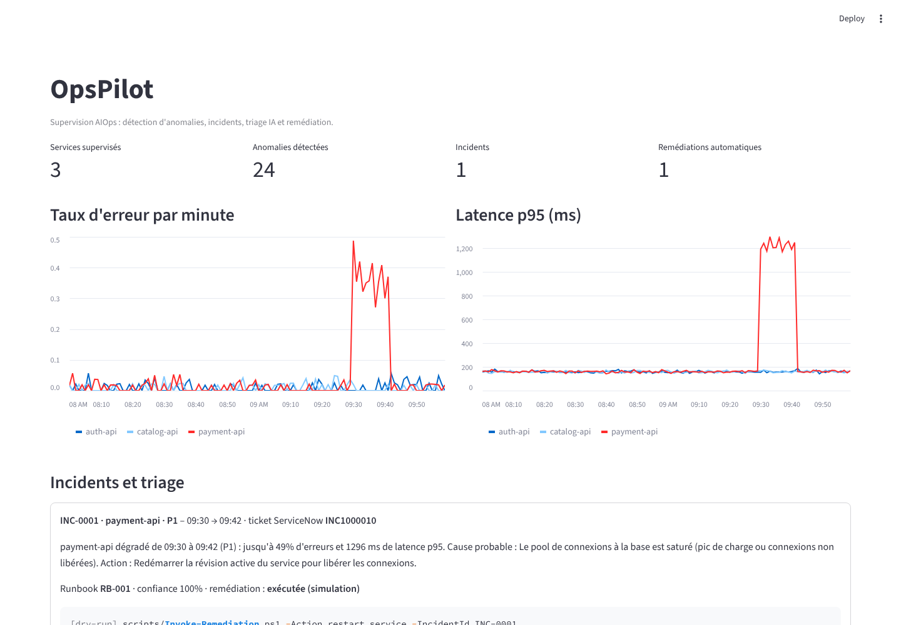
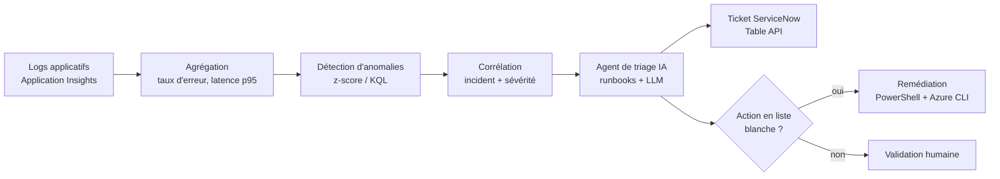

# OpsPilot – Mini-plateforme AIOps sur Azure


Quand un service applicatif se dégrade, l'équipe d'exploitation doit repérer le problème, comprendre sa cause, ouvrir un ticket et appliquer la bonne correction, souvent en pleine nuit.

**OpsPilot automatise cette chaîne de bout en bout** : détection d'anomalies dans les logs, regroupement en incidents, **ticket ServiceNow** créé automatiquement, **triage par un agent IA** à partir de runbooks, puis **remédiation automatique** des cas connus et sûrs. Tout le reste attend une validation humaine.



## Fonctionnement



| Étape | Ce qui est fait |
|---|---|
| **Agrégation** | Taux d'erreur et latence p95 par service et par minute |
| **Détection** | Z-score sur une fenêtre glissante de 30 min, avec un seuil de variation minimale pour éviter les fausses alertes. En production, la même logique tourne en **KQL** (`series_decompose_anomalies`) |
| **Corrélation** | Regroupe les anomalies proches en un incident, calcule la sévérité (P1 à P3) et les erreurs les plus fréquentes |
| **Triage IA** | Rapproche les signatures d'erreurs des **runbooks**, donne la cause probable, l'action et un niveau de confiance. Le résumé peut être rédigé par un LLM |
| **ServiceNow** | Crée l'incident (urgence, impact, CI, notes de travail) via la **Table API** |
| **Remédiation** | Exécute uniquement les actions **en liste blanche** et avec une confiance suffisante, via un script **PowerShell** (`-WhatIf` supporté). Sinon : validation humaine |

## Exemple d'exécution

```
18035 lignes de logs analysées

[Agrégation  ]    21.5 ms  360 points de métriques
[Détection   ]    50.0 ms  24 anomalies
[Corrélation ]     5.1 ms  1 incident(s)
[Triage IA   ]     0.1 ms  1 diagnostic(s)
[ServiceNow  ]     0.0 ms  1 ticket(s) créé(s)
[Remédiation ]     0.0 ms  exécutée (simulation)

INC-0001 · payment-api · P1 · 09:30-09:42 · ticket INC1000010
  Diagnostic (règles, confiance 100%) : payment-api dégradé de 09:30 à 09:42 (P1) : jusqu'à 49% d'erreurs
  et 1296 ms de latence p95. Cause probable : Le pool de connexions à la base est saturé […]
  Remédiation : exécutée (simulation) – [dry-run] scripts/Invoke-Remediation.ps1 -Action restart_service -IncidentId INC-0001
```

Sur les logs simulés, l'incident injecté est détecté exactement sur sa fenêtre (09:30–09:42), sans aucune fausse alerte sur les deux autres services. Un test vérifie aussi qu'aucune anomalie n'est levée sur des logs sans incident.

## Démarrage rapide

```bash
python -m venv .venv && source .venv/bin/activate      # Windows : .venv\Scripts\activate
pip install -e ".[dev,ui]"

python -m opspilot.cli                                 # pipeline complet sur des logs simulés
streamlit run src/opspilot/dashboard.py                # tableau de bord
uvicorn opspilot.api:app --reload                      # API : http://localhost:8000/docs
pytest -q                                              # tests
```

Depuis PowerShell, une fois l'API lancée :

```powershell
./scripts/Get-OpsPilotIncidents.ps1 -ApiUrl http://localhost:8000
./scripts/Invoke-Remediation.ps1 -Action restart_service -IncidentId INC-0001 -WhatIf
```

Sans identifiants ServiceNow ni clé LLM, tout fonctionne en mode simulé : les tickets sont créés dans un faux ServiceNow en mémoire, et le diagnostic est déterministe.

## Déploiement sur Azure

L'infrastructure est décrite en **Terraform** (`infra/terraform`) :

- **Log Analytics** et **Application Insights** pour l'observabilité ;
- **Azure Container Registry** et **Container Apps** pour l'API, avec une identité managée et le rôle AcrPull (aucun mot de passe) ;
- une **alerte Azure Monitor** basée sur une requête KQL (taux d'erreur > 10 % sur 5 min), reliée à un groupe d'action.

```bash
cd infra/terraform
cp terraform.tfvars.example terraform.tfvars   # renseigner l'abonnement et l'e-mail d'astreinte
terraform init && terraform plan && terraform apply
```

Le workflow `Deploy to Azure` (GitHub Actions, déclenchement manuel, connexion **OIDC** sans secret long terme) construit l'image dans ACR et met à jour la Container App.

## Requêtes KQL

| Fichier | Usage |
|---|---|
| `kql/01_metriques_par_minute.kql` | Taux d'erreur et latence p95 par service et par minute |
| `kql/02_detection_anomalies.kql` | Détection d'anomalies avec `make-series` + `series_decompose_anomalies` |
| `kql/03_top_erreurs.kql` | Signatures d'erreurs les plus fréquentes, rapprochées des runbooks |
| `kql/04_alerte_taux_erreur.kql` | Requête de l'alerte Azure Monitor déployée par Terraform |

## CI/CD

Le workflow `CI` vérifie à chaque push :
- Python : ruff, pytest et une exécution complète du pipeline ;
- Terraform : `fmt`, `init` et `validate` ;
- PowerShell : analyse avec **PSScriptAnalyzer** ;
- Docker : build de l'image.

## Structure

```
src/opspilot/   détection, corrélation, agent de triage, client ServiceNow, API, tableau de bord
runbooks/       base de connaissances : signatures d'erreurs -> cause -> remédiation
kql/            requêtes Log Analytics
infra/terraform infrastructure Azure (observabilité, hébergement, alerte)
scripts/        scripts PowerShell (remédiation, consultation des incidents)
tests/          tests unitaires, API et validation de l'infrastructure
```

## Limites et pistes d'amélioration

- Les logs sont **simulés** : la prochaine étape est de brancher le pipeline sur un vrai espace Log Analytics, via l'API de requête KQL.
- Le rapprochement avec les runbooks repose sur des motifs. Une recherche sémantique (embeddings) dans l'historique des incidents améliorerait les cas inconnus.
- La remédiation est en mode *dry-run* par défaut. En production, il faudrait ajouter une approbation dans ServiceNow ou Teams avant chaque action non sûre.

## Auteure

**Oumaima Mrhir** – Étudiante en Master 2 Informatique Décisionnelle (IDEAL), Université de Lorraine
[GitHub](https://github.com/OumaimaMrhir)

Licence MIT.
